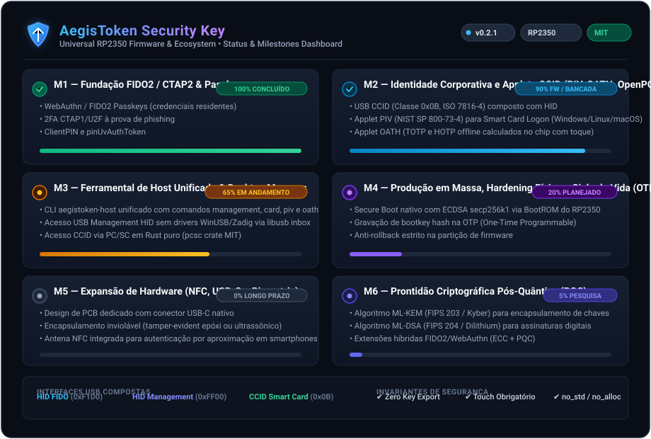
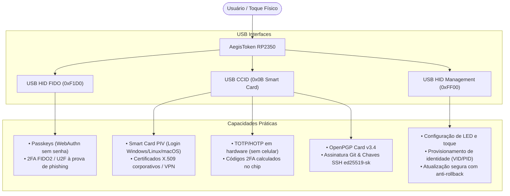

# Milestones — AegisToken Hardware Security Key

Este documento estabelece o **Plano de Milestones** do **AegisToken**, detalhando **o que a chave de segurança física é capaz de fazer** e **quando** cada capacidade é entregue, validada e disponibilizada para uso geral.

O plano alinha o firmware universal em Rust (`aegis-core`, `aegis-applets`, `board-generic-rp2350`, `firmware-universal-rp2350`), o ferramental de host (`aegistoken-host`), o **Desktop Manager** e a evolução física do hardware.



---

## 1. Visão Geral: O que é e o que faz a Chave de Segurança Física

O **AegisToken** é uma chave de segurança física universal baseada no microcontrolador **Raspberry Pi RP2350** (arquitetura ARM Cortex-M33 com TrustZone, acelerador criptográfico SHA-256 e OTP).

Seu propósito fundamental é operar como um **enclave criptográfico isolado e portátil** com duas garantias essenciais:
1. **Segredos Nunca Deixam o Dispositivo:** Chaves privadas de autenticação, assinatura, decifra e sementes TOTP são geradas no chip e seladas via hardware; nunca são expostas ao sistema operacional host.
2. **Consentimento Humano Obrigatório (*User Presence*):** Nenhuma operação crítica ocorre sem que o usuário interaja fisicamente com a chave (toque capacitivo, botão ou BOOTSEL), eliminando ataques remotos silenciosos e botnets.



---

## 2. Taxonomia de Capacidades: O Que a Chave Pode Fazer

### A. Autenticação Web & Passkeys (FIDO2 / CTAP2.1 / WebAuthn)
- **Login sem senha (*Passkeys Residentes*):** Login biométrico ou por PIN em Google, Microsoft Entra ID, GitHub, AWS, Apple, etc.
- **Autenticação em Dois Fatores (2FA) Resistente a Phishing:** O navegador e a chave validam criptograficamente o domínio (`origin`), impedindo que páginas falsas capturem o token.
- **PIN de Usuário (*ClientPIN / pinUvAuthToken*):** Exige PIN numérico ou alfanumérico com bloqueio automático após tentativas incorretas consecutivas.
- **Suporte Criptográfico:** Algoritmos P-256 (ES256) e Ed25519 (EdDSA).

### B. Identidade Corporativa e Smart Card (PIV — NIST SP 800-73-4)
- **Smart Card Logon:** Login nativo em estações de trabalho Windows (Active Directory / Kerberos), macOS e Linux (via PAM / PKCS#11 / OpenSC).
- **TLS Mútuo (mTLS) e VPNs:** Autenticação de rede corporativa e acesso a servidores internos através de certificados cliente X.509 armazenados em slots dedicados (`9A` Autenticação, `9C` Assinatura Digital, `9D` Gestão de Chaves, `9E` Validação de Cartão).
- **Assinatura e Cifra de Arquivos:** Integração direta com utilitários como Adobe Acrobat, LibreOffice e ferramentas corporativas de assinatura digital.
- **Suporte Criptográfico:** ECC (P-256, P-384) e RSA (2048/3072 bits com blinding constante).

### C. Autenticação Temporizada Offline (OATH — TOTP e HOTP)
- **Substituto de Apps Móveis:** Armazena segredos de 2FA que normalmente ficariam no Google Authenticator ou Authy.
- **Cálculo Isolado em Hardware:** O segredo compartilhado (Base32) nunca é lido pelo computador; o host envia apenas o timestamp atual e a chave retorna o código de 6 ou 8 dígitos após toque físico.
- **Proteção por Senha Opcional:** Bloqueio das credenciais OATH com senha mestre.

### D. Segurança para Desenvolvedores e Engenharia (OpenPGP & SSH)
- **Assinatura de Commits Git:** Assinatura criptográfica inviolável de código-fonte (`git commit -S`) via OpenPGP Card v3.4 ou chave SSH de hardware.
- **Acesso a Servidores SSH sem Chave em Disco:** Utilização de `ssh-keygen -t ed25519-sk -O resident` ou encaminhamento do agente GPG (`gpg-agent`), mantendo a chave privada exclusivamente no silício.
- **Criptografia de E-mails e Arquivos:** Criptografia ponta a ponta com GnuPG.

### E. Gestão, Diagnóstico e Telemetria Segura (Management HID)
- **Provisionamento Pós-Flash:** Configuração de strings de fabricante, modelo, VID e PID antes de comissionar o dispositivo.
- **Personalização de Hardware:** Ajuste fino da intensidade do LED, animações de status e mapeamento de GPIO para o botão de toque.
- **Atualização Segura de Firmware:** Upload de imagens `.uf2` assinadas pela autoridade do fornecedor com checagem rigorosa de anti-rollback.

---

## 3. Cronograma de Milestones (Quando e O Quê)

```
2026 Q1-Q2 (Entregue)            2026 Q3-Q4 (Atual)              2027+ (Futuro)
┌─────────────────────────┐     ┌─────────────────────────┐     ┌─────────────────────────┐
│       MILESTONE 1       │     │       MILESTONE 3       │     │       MILESTONE 5       │
│  Fundação FIDO2/Passkey │     │  Desktop Manager & CLI  │     │  Hardware NFC / Biometria│
└────────────┬────────────┘     └────────────┬────────────┘     └────────────┬────────────┘
             │                               │                               │
             ▼                               ▼                               ▼
┌─────────────────────────┐     ┌─────────────────────────┐     ┌─────────────────────────┐
│       MILESTONE 2       │     │       MILESTONE 4       │     │       MILESTONE 6       │
│  Applets CCID: PIV/OATH │     │  Hardening Comercial &  │     │   Criptografia Pós-     │
│   OpenPGP & SSH-SK      │     │  Comissionamento OTP    │     │   Quântica (PQC)        │
└─────────────────────────┘     └─────────────────────────┘     └─────────────────────────┘
```

---

### Milestone 1 (M1) — Fundação FIDO2 / CTAP2 & Passkeys
**Status:** `CONCLUÍDO (Firmware)`  
**Foco:** Estabelecer o dispositivo como um autenticador WebAuthn de alta segurança.

- [x] Arquitetura de firmware em Rust (`no_std`, `no_alloc`, execução assíncrona com `embassy-rp`).
- [x] Interface USB HID FIDO (Usage Page `0xF1D0`) independente.
- [x] Implementação de CTAP1/U2F e CTAP2.0/CTAP2.1.
- [x] Suporte a Passkeys residentes (`rk`), `userVerification` via `clientPIN` (derivação SHA-256/AES-GCM).
- [x] Detecção contextual de presença de usuário via BOOTSEL/botão físico com proteção anti-replay.
- [x] Criptografia assimétrica ECC P-256 e Ed25519.
- [x] Suíte de validação de protocolo com mais de 70 testes automatizados em host e emulação.

---

### Milestone 2 (M2) — Identidade Corporativa e Applets CCID
**Status:** `CONCLUÍDO (Firmware) / EM VALIDAÇÃO DE HARDWARE`  
**Foco:** Adicionar a pilha de Smart Card ISO 7816 / CCID sem quebrar o isolamento do FIDO.

- [x] Interface USB CCID (Classe `0x0B`) composta em paralelo com as interfaces HID.
- [x] Motor de despacho de APDUs e seleção de múltiplos applets por AID em `aegis-applets`.
- [x] **Applet PIV (NIST SP 800-73-4):**
  - Slots `9A`, `9C`, `9D`, `9E` com suporte a chaves ECC e RSA.
  - Chave de gestão (3DES / AES-128 / AES-256) e autenticação de desafio.
  - Importação e armazenamento selado de certificados X.509 em Flash.
- [x] **Applet OATH (TOTP / HOTP):**
  - Armazenamento selado de credenciais Base32 com SHA-1, SHA-256 e SHA-512.
  - Cálculo de códigos de 6 ou 8 dígitos sincronizados com o timestamp do host.
- [x] **Applet OpenPGP Card (v3.4):**
  - Suporte a chaves de Assinatura, Criptografia e Autenticação.
  - Suporte nativo a SSH com chaves protegidas em hardware (`ed25519-sk`).
- [x] Persistência selada de chaves e dados com AES-256-GCM derivada do chip.

---

### Milestone 3 (M3) — Ferramental de Host & Desktop Manager
**Status:** `EM ANDAMENTO (Prazo: 30 a 60 dias)`  
**Foco:** Prover uma experiência de usuário de nível comercial (CLI de diagnóstico e GUI Desktop).

- [x] **CLI de Host (`aegistoken-host`):**
  - Comunicação direta com Management HID via `rusb` (sem drivers WinUSB/Zadig).
  - Suporte a PC/SC em Rust puro (`pcsc` crate MIT) para inspeção de Smart Card e APDUs (`card-list`, `card-status`, `card-apdu`).
  - Gestão de certificados PIV (`piv-list`, `piv-import-cert`, `piv-set-mgmt-key`) com crates `x509-cert` e `der`.
  - Gestão de contas OATH no terminal (`oath list`, `oath code`, `oath add otpauth://`, `oath delete`).
- [ ] **Desktop Manager Multiplataforma (Tauri v2 + Rust):**
  - **Identidade e Hardware:** Painel visual exibindo modelo, número de série da OTP do chip e saúde do dispositivo.
  - **Customizador de LED e Toque:** Ajuste visual de cor, brilho, comportamento e confirmação em tela do toque de presença.
  - **Gerenciador de Passkeys:** Interface para listar relying parties salvas e revogar credenciais obsoletas mediante PIN.
  - **Autenticador 2FA Visual:** Leitor de tela para importar QR Codes de TOTP com barra circular de tempo de expiração (30s).
  - **Assistente de Certificados PIV:** Geração de par de chaves no token com exportação de CSR (*Certificate Signing Request*) e importação do certificado assinado com 1 clique.
- [ ] **Instaladores Oficiais:** Empacotamento para Windows (`.msi`), Linux (`.deb` / Flatpak) e macOS (`.dmg`).

---

### Milestone 4 (M4) — Produção em Massa, Hardening Físico e Ciclo de Vida
**Status:** `PLANEJADO (Prazo: 60 a 120 dias)`  
**Foco:** Fechar o ciclo de segurança física para implantação em frotas corporativas e vendas.

- [ ] **Transição de Ciclo de Vida (`Factory` -> `Commissioning` -> `Active`):**
  - Bloqueio permanente de alteração de VID/PID e strings USB após o comissionamento.
- [ ] **Secure Boot Nativo do RP2350:**
  - Queima do hash da chave pública do fornecedor na OTP (*One-Time Programmable memory*).
  - Bloqueio de portas de depuração SWD contra leitura externa de memória.
- [ ] **Anti-Rollback por Hardware:**
  - Aplicação estrita da versão de rollback na tabela de partição para impedir regresso a firmwares vulneráveis.
- [ ] **Atestação de Chave FIDO (Batch Attestation):**
  - Injeção segura em fábrica de par de chaves e certificado de atestação X.509 assinado pela CA oficial do AegisToken para verificação em serviços Enterprise (FIDO Metadata Service - MDS).
- [ ] **Documentação de Manufatura e Teste de Bancada Automatizado:**
  - Script industrial de *flashing*, provisionamento de OTP e teste funcional em esteira de produção.

---

### Milestone 5 (M5) — Expansão de Hardware: NFC, USB-C e Biometria
**Status:** `EVOLUÇÃO DE HARDWARE (Prazo: 6 a 12 meses)`  
**Foco:** Desenvolver novas revisões físicas do dispositivo além da placa de bancada.

- [ ] **Fator de Forma Comercial (PCB Dedicada):**
  - Conector USB-A e USB-C integrado diretamente na placa, em encapsulamento plástico ultrassônico ou resina epóxi inviolável (*tamper-evident*).
- [ ] **Interface Sem Contato (NFC):**
  - Transceiver NFC integrado ao RP2350 para leitura por aproximação em smartphones Android e iOS (FIDO2 e OATH via ISO 14443 Type A).
- [ ] **Sensor Biométrico de Impressão Digital (Opcional por Modelo):**
  - Sensor capacitivo integrado na carcaça para autenticação biométrica local (*Match-on-Card*), satisfazendo o requisito de *User Verification* (UV) do FIDO sem exigir a digitação do PIN no computador.

---

### Milestone 6 (M6) — Prontidão Pós-Quântica (PQC)
**Status:** `FUTURO & PADRONIZAÇÃO (Prazo: 12 a 24 meses)`  
**Foco:** Proteger o usuário contra a quebra futura da criptografia assimétrica por computadores quânticos (*Store Now, Decrypt Later*).

- [ ] **Adoção dos Padrões FIPS 203 & 204:**
  - Integração de implementações em Rust puro sob `MIT OR Apache-2.0` de **ML-KEM** (Kyber) para encapsulamento de chaves e **ML-DSA** (Dilithium) para assinaturas digitais.
- [ ] **Extensões Híbridas CTAP2 & WebAuthn:**
  - Adoção dos rascunhos de padronização da FIDO Alliance para chaves de atestação híbridas (ECC P-256 + ML-DSA).
- [ ] **OpenPGP Pós-Quântico:**
  - Suporte a subchaves híbridas no applet OpenPGP para assinatura e criptografia quântico-resistente.

---

## 4. Matriz Rastreável de Capacidades x Milestones

| Capacidade do Produto | M1 (FIDO2) | M2 (CCID) | M3 (Manager) | M4 (Produção) | M5 (Hardware) | M6 (PQC) |
|---|:---:|:---:|:---:|:---:|:---:|:---:|
| **Login Web sem Senha (Passkeys)** | :white_check_mark: | :white_check_mark: | :white_check_mark: | :white_check_mark: | :white_check_mark: | :white_check_mark: |
| **Segundo Fator 2FA Anti-Phishing** | :white_check_mark: | :white_check_mark: | :white_check_mark: | :white_check_mark: | :white_check_mark: | :white_check_mark: |
| **Smart Card PIV (Windows / PAM)** | :x: | :white_check_mark: | :white_check_mark: | :white_check_mark: | :white_check_mark: | :white_check_mark: |
| **Códigos 2FA em Hardware (TOTP)** | :x: | :white_check_mark: | :white_check_mark: | :white_check_mark: | :white_check_mark: | :white_check_mark: |
| **Assinatura Git & Chaves SSH-SK** | :x: | :white_check_mark: | :white_check_mark: | :white_check_mark: | :white_check_mark: | :white_check_mark: |
| **Gerenciamento Gráfico (Desktop GUI)** | :x: | :x: | :white_check_mark: | :white_check_mark: | :white_check_mark: | :white_check_mark: |
| **Leitura de QR Code para TOTP** | :x: | :x: | :white_check_mark: | :white_check_mark: | :white_check_mark: | :white_check_mark: |
| **Secure Boot & OTP Lock** | :x: | :x: | :x: | :white_check_mark: | :white_check_mark: | :white_check_mark: |
| **Atestação Oficial FIDO MDS** | :x: | :x: | :x: | :white_check_mark: | :white_check_mark: | :white_check_mark: |
| **Comunicação por Aproximação (NFC)** | :x: | :x: | :x: | :x: | :white_check_mark: | :white_check_mark: |
| **Biometria Integrada na Chave** | :x: | :x: | :x: | :x: | :white_check_mark: | :white_check_mark: |
| **Criptografia Quântico-Resistente** | :x: | :x: | :x: | :x: | :x: | :white_check_mark: |

---

## 5. Governança e Regras de Engenharia

Para que cada milestone seja aprovado, o projeto deve cumprir rigorosamente as seguintes diretrizes:

1. **Licenciamento 100% Permissivo (`MIT OR Apache-2.0`):**
   - É estritamente proibida a incorporação de código com licenças restritivas ou virais (`GPL`, `LGPL`), garantindo liberdade total para uso pessoal, governamental e industrial.
2. **Isolamento de Domínio:**
   - O código criptográfico e de protocolo reside em `aegis-core` e `aegis-applets` em ambiente `no_std`/`no_alloc`, testável independentemente em host sem depender de hardware físico.
3. **Sem Exportação de Chaves Privadas:**
   - O AegisToken jamais disponibiliza comandos ou APIs para extração de chaves privadas; todas as operações assimétricas ocorrem estritamente dentro do processador.
4. **Gates Obrigatórios de Validação:**
   - Nenhum commit é integrado sem passar pela suíte de validação:
     - `cargo fmt --all --check`
     - `cargo clippy --all-targets -- -D warnings`
     - `cargo test` para todos os crates
     - Validação de compilação de firmware com alvo `thumbv8m.main-none-eabihf`
